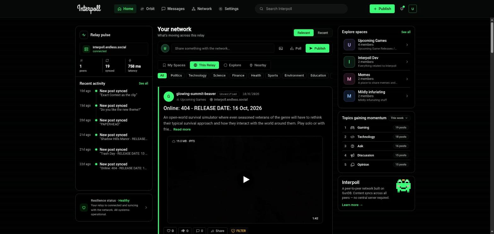
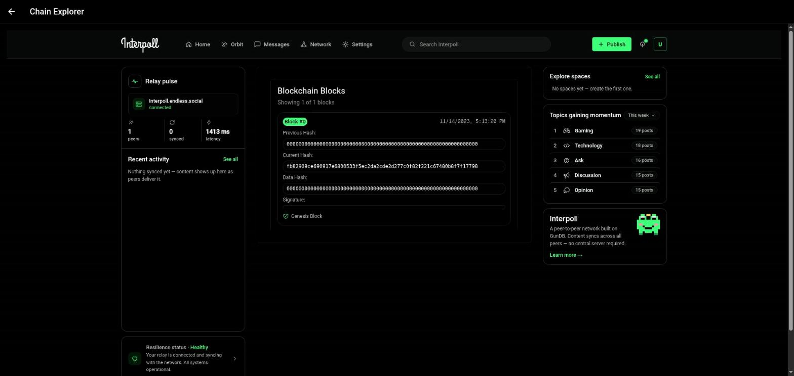
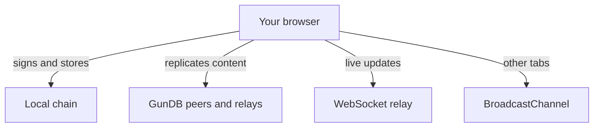
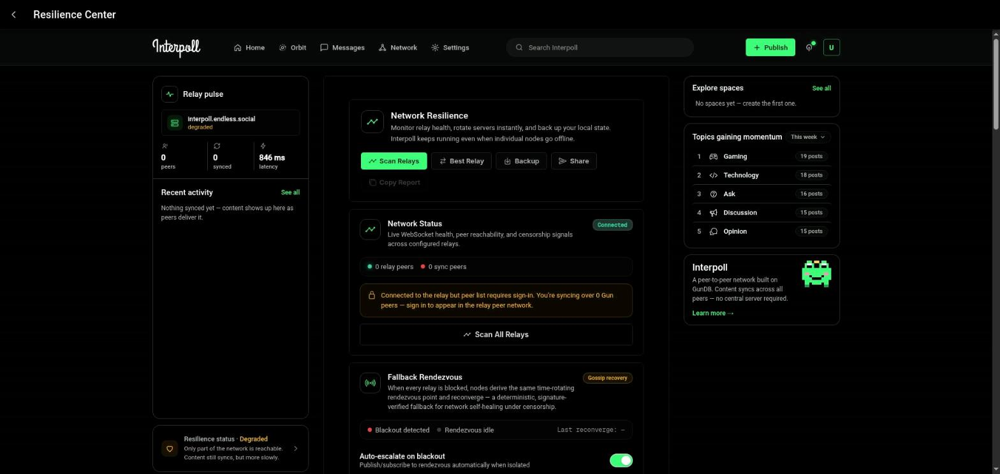

# InterPoll

**Polls and discussions that nobody can switch off.**

Live at **[endless.social](https://endless.social)** · [Releases](https://github.com/Interpoll1/decentralised/releases) · Public domain

<p align="center">
  
</p>

## Why this exists

Most platforms can delete your community overnight. A moderator changes, a policy shifts, a company gets bought, and years of conversation vanish. We got tired of that.

InterPoll keeps your polls, posts and votes on *your* device first, then spreads copies across other people's devices and a handful of relays anyone can run. There's no central database to seize and no single account that can pull the plug. If a relay dies, the next peer that comes online puts everything back.

## What you get

- **Votes you can prove.** Every vote is signed by a key that never leaves your device, and each one is chained to the one before it. Try to rewrite history and the chain visibly breaks. You get a short receipt code after voting and can check it yourself in the Chain Explorer.
- **Polls, posts and threaded comments.** Run a whole community, not just a one-off poll.
- **Private communities.** Content is encrypted in your browser (AES-256-GCM). Relays only ever carry scrambled bytes. Lose your key and it's gone for good, which is the point.
- **Works offline.** Vote on a train; it syncs when you're back online.
- **Direct messages, group chats and 1:1 calls.** Calls go peer to peer. If a firewall gets in the way, our relay forwards the *encrypted* stream and can't see inside it.
- **No feed algorithm.** You see what your communities post, in order.
- **Anyone can run a relay.** A small Node server is all it takes (see below).

<p align="center">
  
</p>

## How it works, in plain terms

Three layers, each doing one job:

1. **Your local chain.** Votes and key actions are written to a tamper-evident log in your browser (IndexedDB), signed with your device key.
2. **The shared graph.** Polls, posts, comments, communities and profiles live in [GunDB](https://gun.eco) and replicate across every connected peer and relay.
3. **Live sync.** A WebSocket relay helps devices find each other and pushes new blocks in real time. Open tabs of the same browser stay in step through BroadcastChannel.



A relay can be slow, or even hostile, but it **can't forge** a signed action from your key. The full spec (block format, sync, encryption, trust model) is the [IPP series](docs/protocol/IPP-00-overview.md).

<p align="center">
  
</p>

## Straight talk about limits

InterPoll is built to be *harder* to censor and tamper with, not impossible.

- Data survives as long as at least one honest peer keeps a copy and reconnects.
- Our anti-fraud layers (device fingerprinting, two-step vote authorization, single-use invites, optional Google/Microsoft sign-in) make duplicate voting expensive. They don't give you mathematically perfect one-person-one-vote.
- Private community keys can't be recovered. Back them up.

## Run it yourself

You need Node 20+.

```bash
npm install
./run.sh                 # starts everything in tmux
```

Or start the pieces by hand:

```bash
npm run dev                                # app → http://localhost:5173
node relay-server.js                       # WebSocket relay → ws://localhost:8080
cd gun-relay-server && node gun-relay.js   # Gun relay → http://localhost:8765/gun
```

Want to help the network without running a full relay? `node peer.js` runs a headless peer that just keeps a copy of the data.

### Configuration

Frontend (set at build time):

| Variable | Default | What it's for |
|---|---|---|
| `VITE_WS_RELAY_URL` | `ws://localhost:8080` | WebSocket relay |
| `VITE_GUN_RELAY_URL` | `http://localhost:8765/gun` | Gun relay |
| `VITE_API_BASE_URL` | `http://localhost:8080` | Backend API |

Users can also change relay URLs in Settings at runtime.

Relay server:

| Variable | Default | What it's for |
|---|---|---|
| `FRONTEND_ORIGIN` | `http://localhost:5173` | CORS origin |
| `SERVER_ORIGIN` | `http://localhost:8080` | Public origin for OAuth callbacks (HTTPS in production) |
| `JWT_SECRET` | random per run | Signs session tokens |
| `VOTE_RESERVATION_SECRET` | random per run | Signs vote reservation tokens |
| `GOOGLE_CLIENT_ID` / `GOOGLE_CLIENT_SECRET` | none | Google sign-in (optional) |
| `MS_CLIENT_ID` / `MS_CLIENT_SECRET` / `MS_TENANT` | none | Microsoft sign-in (optional) |

Copy `.env.example` as a starting point. OAuth is only needed for polls that require a verified login.

### Everyday commands

```bash
npm run dev       # dev server
npm run build     # production build
npm test          # test suite
npm run lint      # lint and auto-fix
```

## Desktop app

The same app, wrapped with [Tauri v2](https://tauri.app) in `src-tauri/`. It uses whatever relays you've configured.

```bash
npm run desktop:dev     # dev window
npm run desktop:build   # release build and installers
```

Linux builds need `webkit2gtk-4.1`, `libsoup-3.0` and Rust. Windows and macOS installers have to be built on those systems. The Windows one is produced by [`release-windows.yml`](.github/workflows/release-windows.yml) when a `v*` tag is pushed, and lands on the [Releases page](https://github.com/Interpoll1/decentralised/releases), the only official place to download it.

### Code signing policy

Windows releases are signed for free by [SignPath.io](https://signpath.io) with a certificate from the [SignPath Foundation](https://signpath.org).

- **What gets signed:** only the installer built by the release workflow from a tagged commit in this repository. Local and fork builds are never signed.
- **Who approves:** the maintainers of [Interpoll1](https://github.com/Interpoll1) review and approve every signing request.
- **Privacy:** the desktop app has no telemetry. It only talks to the relays you configure, and keeps your data on your device.

## Where things live

```
src/                 Vue 3 + Pinia app (components, views, services, stores)
relay-server.js      Dev WebSocket relay, OAuth, vote authorization
gun-relay-server/    Gun relay
community-relay/     One-command relay kit for communities
shared-validation/   Validation shared by the app and relays
src-tauri/           Desktop wrapper
docs/protocol/       The IPP specification
```

## Contributing

It's open source and PRs are welcome. Run `npm test` and `npm run lint` before you open one. If you find a security problem, please open a private security advisory on GitHub rather than a public issue.

## License

[The Unlicense](https://unlicense.org). Public domain, do what you like. See [LICENSE](LICENSE).
