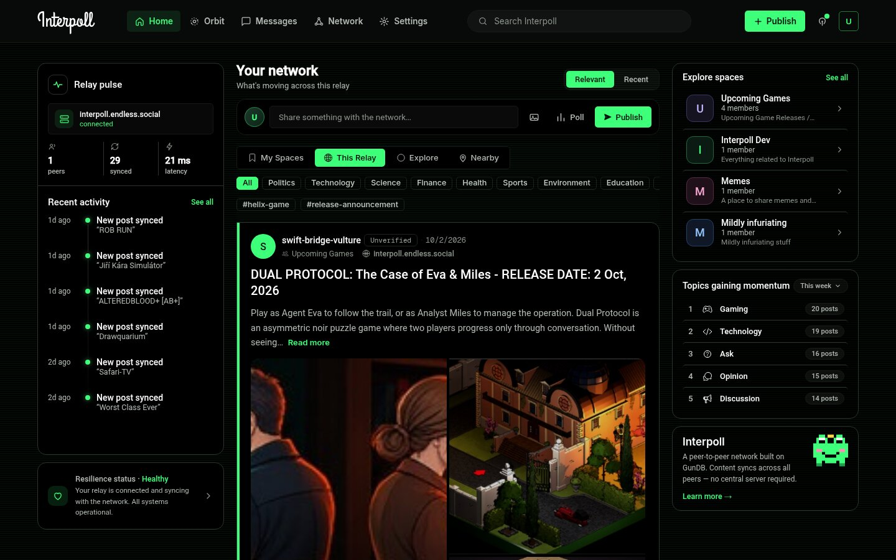
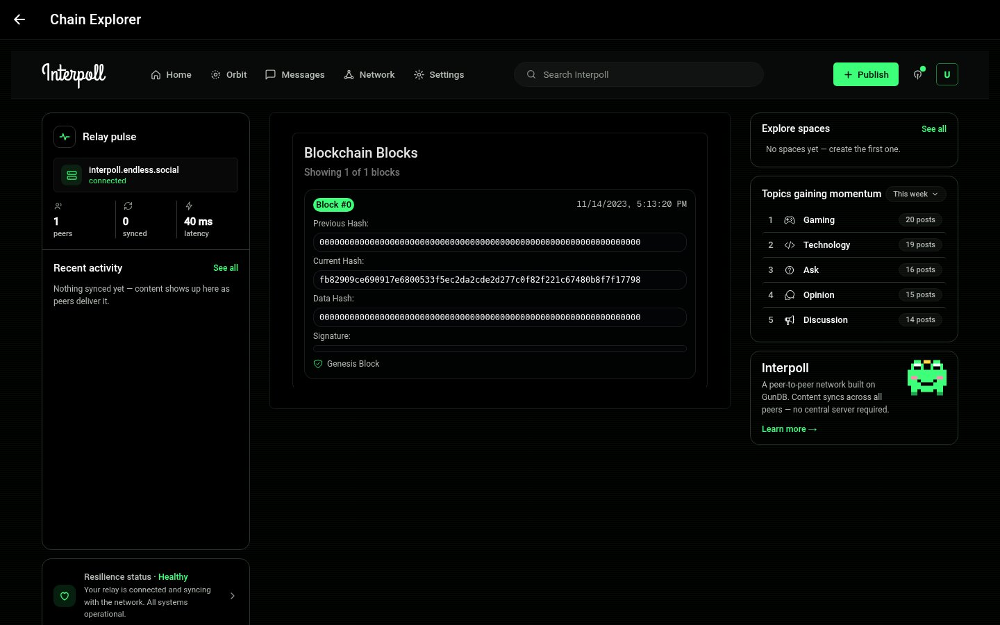
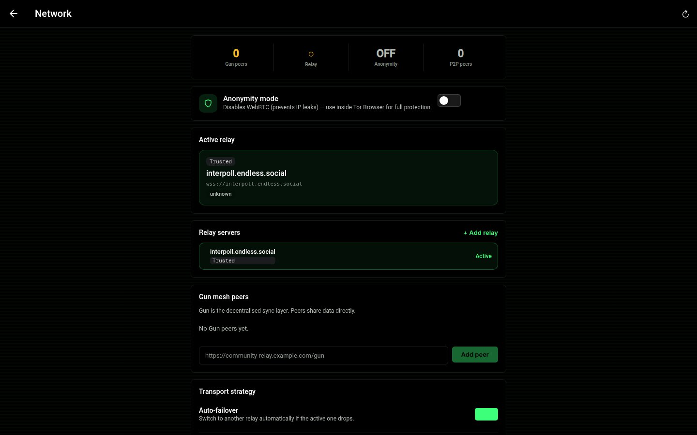
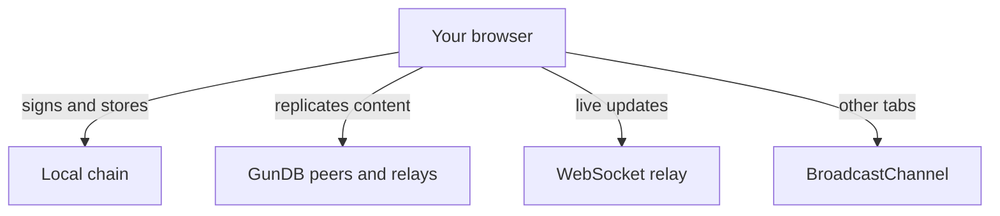
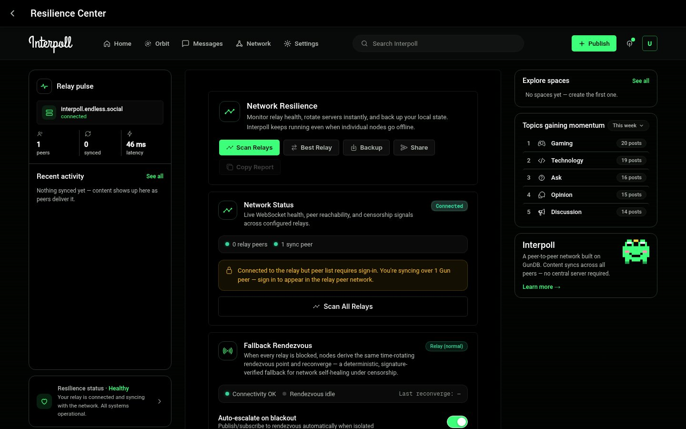
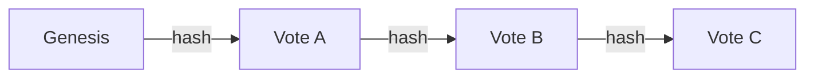

<p align="center">
  
</p>

<p align="center">
  <a href="https://endless.social"></a>
  <a href="https://endless.social"></a>
  <a href="https://github.com/Interpoll1/decentralised/releases"></a>
  <a href="https://github.com/Interpoll1/decentralised/commits/master"></a>
  <a href="LICENSE"></a>
</p>

<p align="center">
  <b><a href="https://endless.social">Open the app</a></b> ·
  <a href="#run-it-locally">Run it locally</a> ·
  <a href="#desktop-and-android">Desktop &amp; Android</a> ·
  <a href="docs/protocol/IPP-00-overview.md">Read the spec</a>
</p>

<p align="center">
  
</p>

# InterPoll

InterPoll is a place to run polls and have the conversation around them, built so that no one company, moderator or server can quietly take it away from you.

Your polls, posts, comments and votes are saved on your own device first. From there they spread to other people's devices and to a handful of small relay servers that anyone can run. Every action is signed with a key that stays in your browser, so a relay can be slow, offline, or even hostile, but it can't put words in your mouth or change a vote.

The live app is at **[endless.social](https://endless.social)**. This repository is everything behind it.

## Why we built it

Communities get deleted. A moderator leaves, a policy changes, a startup gets bought, and years of discussion disappear with one click. We'd watched that happen enough times to want something different: a platform where the data doesn't have a single owner, so there's nothing for anyone to switch off.

That's also why the app is a plain website first. You don't install anything to try it. Open the link and you're in.

## What it does

- **Votes you can check.** Each vote is signed on your device and chained to the one before it, so rewriting history visibly breaks the chain. After voting you get a short receipt code, and you can look it up yourself in the Chain Explorer.
- **Polls, posts and threaded comments.** Whole communities, not just one-off polls.
- **Private communities.** Content is encrypted in your browser with AES-256-GCM before it leaves, so relays only ever carry scrambled bytes. If you lose the key, the data is gone for good. That's deliberate.
- **Works offline.** Vote on the train, it syncs when you're back.
- **Direct messages, group chats and 1:1 calls.** Calls go peer to peer. When a firewall gets in the way, a relay can forward the *encrypted* stream, but it can't see inside it.
- **A feed you tune yourself.** Ranking runs on your device, using weights and keywords you choose. There's no server-side algorithm deciding what you see.
- **Run your own relay.** A relay is a small Node program. The app has a guided flow for it under Settings → Network.

<table>
  <tr>
    <td width="50%"><br /><sub><b>Chain Explorer.</b> Every block, hash and signature, checkable by you.</sub></td>
    <td width="50%"><br /><sub><b>Network.</b> See which relay you're on, add your own, or turn on Anonymity mode.</sub></td>
  </tr>
</table>

## How it works

There are three layers, and each does one job.

1. **A local chain.** Votes and key actions go into a tamper-evident log in your browser (IndexedDB), signed with your device key.
2. **A shared graph.** Polls, posts, comments, communities and profiles live in [GunDB](https://gun.eco) and replicate across connected peers and relays.
3. **Live sync.** A WebSocket relay helps devices find each other and pushes new blocks as they happen. Tabs of the same browser stay in step through BroadcastChannel.



The part worth remembering: a relay can delay or drop your messages, but it can't forge one. The block format, sync rules, encryption and trust model are written up in full in the [IPP specification](docs/protocol/IPP-00-overview.md).

<p align="center">
  <br />
  <sub><b>Resilience Center.</b> If every relay gets blocked, nodes work out the same fallback meeting point and find each other again.</sub>
</p>

<details>
<summary><b>What actually happens when you vote?</b></summary>

1. Your vote becomes a block: the payload, a timestamp and your device key.
2. The block is hashed with SHA-256 and linked to the previous block.
3. It's signed with your key and saved locally.
4. You get a receipt code to look up in the Chain Explorer.
5. The block goes out to peers over WebSocket and BroadcastChannel.
6. The relay hands your app a short-lived token (`/api/vote-authorize`) and the app confirms it (`/api/vote-confirm`). That two-step handshake is what stops one device registering the same vote twice.



</details>

## What it can't do

InterPoll is meant to be harder to censor and tamper with. It isn't unbreakable, and we'd rather say so up front.

- Your data lives on as long as at least one honest peer keeps a copy and comes back online.
- The anti-fraud layers (device fingerprinting, two-step vote authorization, single-use invites, optional Google or Microsoft sign-in) make duplicate voting expensive. They don't give you mathematically perfect one-person-one-vote.
- Keys for private communities can't be recovered by anyone, including us. Back them up.

## Run it locally

You'll need Node 20 or newer.

```bash
npm install
npm run dev        # the app at http://localhost:5173
```

That's enough to start. Out of the box the app talks to the public relays, so you can poke around without running any server of your own.

To run a relay of your own, use the community relay kit:

```bash
(cd community-relay/kit && npm install)    # once
node community-relay/kit/relay.js          # Gun relay at http://localhost:8765/gun
```

Then point the app at it in Settings → Network, or build with `VITE_GUN_RELAY_URL=http://localhost:8765/gun`. The kit's own [README](community-relay/README.md) covers the one-line installers for home servers (Linux, Raspberry Pi, macOS, Windows) and for a cloud VPS with automatic TLS.

Want to help the network without running a full relay? `node peer.js` starts a headless peer that does nothing but keep a copy of the data. It takes `--ws`, `--gun`, `--api`, `--data` and `--proxy` flags if you want to aim it somewhere else.

> **Heads up:** the production WebSocket and OAuth relay in `relay-server/` is deployed from our server and can't start from a plain clone. For local work, the community relay above is the supported route.

### Configuration

The app reads these at build time:

| Variable | What it sets |
|---|---|
| `VITE_WS_RELAY_URL` | WebSocket relay |
| `VITE_GUN_RELAY_URL` | Gun relay |
| `VITE_API_BASE_URL` | Backend API |

Anyone can also change the relay URLs at runtime in Settings, and the choice is remembered in that browser. [`.env.example`](.env.example) lists the server-side variables our production relay uses.

### Everyday commands

```bash
npm run dev       # dev server
npm run build     # production build
npm test          # test suite
npm run lint      # lint, with auto-fix
```

## Desktop and Android

The desktop app is the same code wrapped with [Tauri v2](https://tauri.app) (`src-tauri/`). It uses whichever relays you've configured.

```bash
npm run desktop:dev       # dev window
npm run desktop:build     # release build and installers
```

Linux builds need `webkit2gtk-4.1`, `libsoup-3.0` and Rust. Windows and macOS installers have to be built on those systems. The Windows installer is produced by a release workflow whenever a `v*` tag is pushed, and it lands on the [Releases page](https://github.com/Interpoll1/decentralised/releases), the only official place to download it.

The Android app uses [Capacitor](https://capacitorjs.com). `npm run cap:android` builds the web bundle, syncs it into `android/` and opens Android Studio.

### Code signing policy

Windows releases are signed for free by [SignPath.io](https://signpath.io), using a certificate from the [SignPath Foundation](https://signpath.org).

- **What gets signed:** only the installer built by the release workflow from a tagged commit in this repository. Local and fork builds are never signed.
- **Who approves:** the maintainers of [Interpoll1](https://github.com/Interpoll1) review every signing request.
- **Privacy:** the desktop app has no telemetry. It only talks to the relays you configure and keeps your data on your device.

## Where things live

```
src/                 Vue 3 + Pinia app: components, views, services, stores
community-relay/     Relay kit and installers for self-hosting
relay-server/        Production WebSocket relay, OAuth, vote authorization
gun-relay/           Production Gun relay
shared-validation/   Validation shared by the app and the relays
src-tauri/           Desktop wrapper
android/             Android wrapper
docs/protocol/       The IPP specification
```

## Contributing

Pull requests are welcome. Before you open one, run `npm test` and `npm run lint`. If you've found a security problem, please open a private security advisory on GitHub instead of a public issue, so we can fix it before it's widely known.

## License

See [LICENSE](LICENSE) for the terms this repository is released under.
