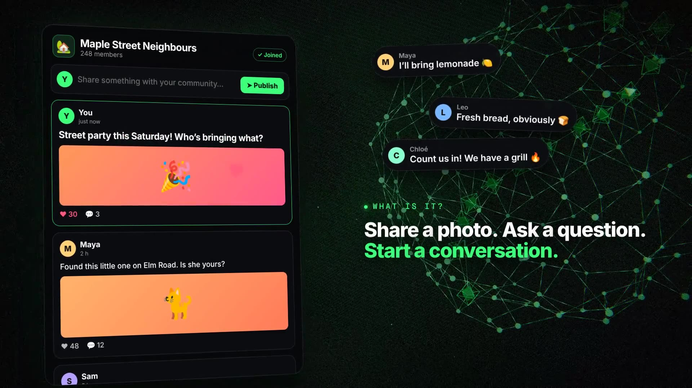

# InterPoll video ad for everyone (EN + FR)

A second ad, written for people who have never heard of InterPoll and don't care how it works. It answers "what is this?" and "why would I use it?" in plain words, and it is about posts and communities; a poll only appears as one small post in the feed.

It reuses the pipeline from [`../video-ad`](../video-ad/README.md) (Three.js scenes rendered frame by frame, Chatterbox voiceover checked with Whisper, synthesized score). Build steps are the same; the lengths are 64 s (English, 1920 frames) and 68 s (French, 2040 frames).

## Story

1. A group you love: posts from neighbours, bakers, stargazers.
2. On most apps it belongs to a company: ads push in, a post gets hidden, and an admin switch deletes the group.
3. InterPoll: a feed where someone writes a post, publishes it, and the replies and likes arrive.
4. No ads, no tracking, your feed your rules.
5. Private messages only you and your friends can read.
6. The community lives on its members' devices, so the off switch does nothing.
7. `endless.social`: free, no ads, nothing to install.

## Copy rules

No jargon on screen or in the voiceover (no hashes, relays or encryption names). Every claim still maps to the project README. The French script avoids the verb "éteindre" because the synthetic voice pronounced it like "étendre".
