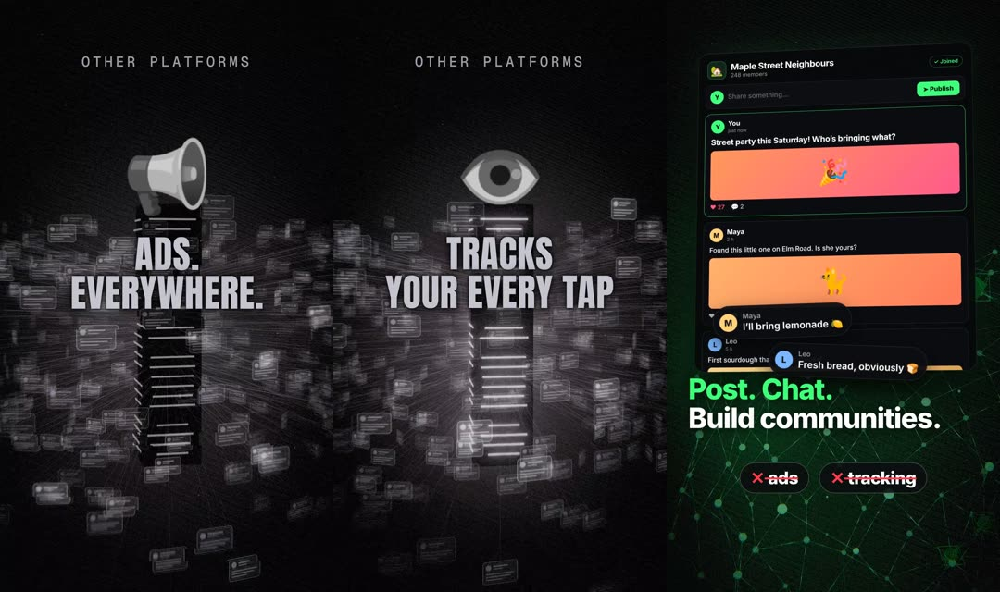

# InterPoll vertical videos: short ad and phonk edit (EN + FR)

Two 1080×1920 videos for Shorts, Reels and TikTok, built on the same pipeline as [`../video-ad`](../video-ad/README.md).

| Video | Length | Sound | Open with |
|---|---|---|---|
| Short ad | about 19 s (EN), 20.5 s (FR) | Chatterbox voiceover over the synthesized score | `index.html?v=short&lang=en` |
| Phonk edit: other platforms vs InterPoll | 26 s | Synthesized 130 BPM phonk track, no voice | `index.html?v=phonk&lang=en` |

## Files

- `scenes.js` holds both cuts; `build3.py` stitches it onto the shared 3D code from `../video-ad-everyone/main.js` to produce `main.js`.
- `cue_short_*.json` and `cue_phonk.json` are the cue sheets.
- `audio/phonk_music.py` synthesizes the phonk track (cowbell riff and 808 in C# minor, kick-pumped; low-passed but still driving on the "other platforms" bars). `audio/short_music.py` scores the short.
- `render.mjs v lang start end port` renders frames to `frames/{v}_{lang}/`.

## Copy rules

The phonk edit names real platforms (Facebook, Instagram, X, TikTok, Reddit, Discord) as plain text, with no logos. Each line is limited to something verifiable about the platforms listed above it: they show ads, they track activity to target ads (per their own privacy policies), they rank feeds algorithmically, and the company can remove a community. It does not claim that any of them sells personal data. The InterPoll lines are the same claims as the project README.
